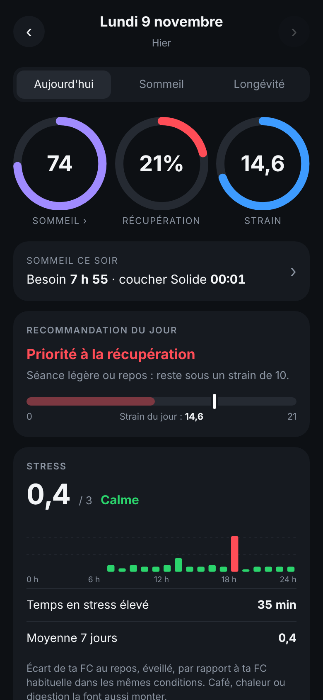
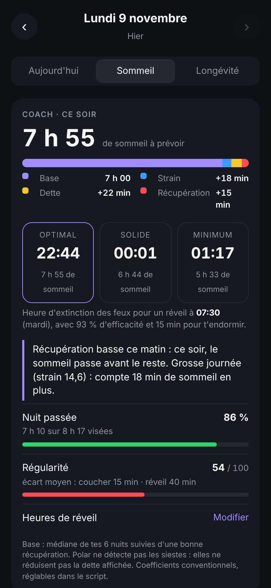
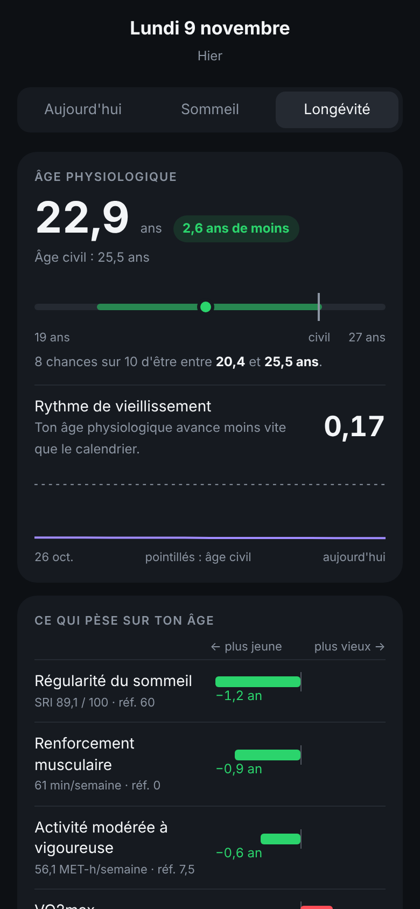

# Polar Dashboard

🇬🇧 [English version](README.md)

Un Google Apps Script qui lit les données d'une montre **Polar** via l'API officielle **Polar AccessLink**, calcule des
indicateurs quotidiens dans un **Google Sheet** et les affiche dans un **dashboard web privé**, pensé pour le téléphone.

Tout tourne dans ton propre compte Google : pas de serveur, pas d'abonnement, pas de base de données externe.

| Aujourd'hui | Sommeil | Longévité |
|---|---|---|
|  |  |  |

<sub>Captures réalisées avec des données fictives générées par le simulateur des tests.</sub>

## Fonctionnalités

- **Récupération (0–100)** à partir de la HRV, de la FC et de la respiration nocturnes et du score de sommeil, comparés à
  ta propre moyenne sur 28 jours. Zones verte, jaune, rouge et recommandation d'effort.
- **Strain (0–21)** de la journée entière : séances enregistrées + FC continue hors séances.
- **Stress** heure par heure : écart de ta FC éveillée au repos par rapport à ta référence.
- **Activité** : pas, calories, charge d'entraînement (ratio aigu/chronique).
- **Sommeil** : hypnogramme, phases, continuité, FC / HRV / respiration de la nuit, Nightly Recharge, 7 dernières nuits.
- **Coach de sommeil** : besoin de sommeil du soir (base, strain, dette, récupération) et trois heures de coucher
  conseillées selon ton heure de réveil, réglable jour par jour depuis le dashboard.
- **Longévité** : âge physiologique avec intervalle d'incertitude et rythme de vieillissement, calculés à partir de
  courbes dose-réponse publiées (VO2max, FC de repos, pas, activité, renforcement, durée et régularité du sommeil).
- **Journal** : coche « alcool » ou « repas tardif » dans le Sheet pour voir leur effet sur ta récupération du lendemain.

Le détail des formules et des sources est dans [docs/fr/METHODE.md](docs/fr/METHODE.md), la structure du Sheet dans
[docs/fr/FEUILLES.md](docs/fr/FEUILLES.md).

## Prérequis

- Une montre Polar synchronisée avec Polar Flow, avec la FC continue activée.
- Un compte Google.
- Pour développer en local (facultatif) : Node.js 18 ou plus et [clasp](https://github.com/google/clasp).

## Installation

### 1. Créer le Sheet et le script

1. Crée un Google Sheet vide.
2. Menu **Extensions → Apps Script**.
3. Remplace le contenu de `Code.gs` par celui de [`src/Code.js`](src/Code.js).
4. Ajoute un fichier HTML nommé exactement **`Dashboard`** et colles-y [`src/Dashboard.html`](src/Dashboard.html).
5. Dans **Paramètres du projet**, coche « Afficher le fichier manifeste » et remplace `appsscript.json` par
   [`src/appsscript.json`](src/appsscript.json) (fuseau Europe/Paris, application web). Adapte `timeZone` si besoin.

Avec clasp, à la place : copie `.clasp.json.example` en `.clasp.json`, mets-y l'ID de ton script, puis `clasp push`.

### 2. Déployer l'application web

**Déployer → Nouveau déploiement → Application Web** :

- Exécuter en tant que : **moi** ;
- Qui a accès : **tout le monde** (nécessaire pour le retour de Polar et l'accès depuis ton téléphone ; le dashboard
  reste protégé par une clé privée).

Copie l'URL qui se termine par `/exec`. **Ne crée plus jamais de nouveau déploiement ensuite** : l'URL changerait et
la connexion Polar comme le lien du dashboard casseraient. Pour publier une mise à jour, modifie le déploiement existant
(« Gérer les déploiements → Modifier → Nouvelle version »), ou avec clasp :

```bash
clasp deploy -i <ID_DU_DEPLOIEMENT> -d "description"
```

### 3. Créer le client Polar AccessLink

1. Sur [admin.polaraccesslink.com](https://admin.polaraccesslink.com), crée un client API.
2. Mets comme **URL de redirection** l'URL `/exec` de l'étape 2.
3. Dans Apps Script, **Paramètres du projet → Propriétés du script**, ajoute `CLIENT_ID` et `CLIENT_SECRET`.

### 4. Connecter ton compte Polar

1. Exécute la fonction `afficherLienAutorisation` (menu **Polar** du Sheet, ou depuis l'éditeur : le lien est dans
   le journal d'exécution).
2. Ouvre le lien, autorise l'accès : la page « Connexion Polar réussie » s'affiche.

### 5. Premières données et mises à jour automatiques

1. Exécute `majQuotidienne` une fois (Google demande les autorisations au premier lancement).
2. Exécute `installerDeclencheurs` : mise à jour automatique à 9 h, 13 h et 21 h.
3. Exécute `creerLienDashboard` : il affiche ton lien privé (`…/exec?k=…`). Ouvre-le sur ton téléphone et ajoute-le à
   l'écran d'accueil. **Ne partage pas ce lien** : la clé qu'il contient donne accès à tes données.

## Sécurité et données

- Les secrets (`CLIENT_ID`, `CLIENT_SECRET`, `ACCESS_TOKEN`, `DASH_KEY`) restent dans les **propriétés du script**.
  Ils ne sont jamais écrits dans le code, le Sheet ni le dashboard.
- Tes données restent dans ton Google Sheet. Le script n'appelle que l'API Polar.
- Pour te reconnecter à Polar : supprime la propriété `ACCESS_TOKEN` puis refais l'étape 4.
- Le fichier `.clasp.json` (ID de ton script) est ignoré par git.

## Développement

```bash
npm test          # tests unitaires et d'intégration (aucun réseau, aucun compte nécessaire)
npm run apercu    # génère apercu.html : le dashboard avec des données fictives, à ouvrir dans un navigateur
```

- `tests/simulateur.js` simule Google Sheets, UrlFetch et une API Polar fictive : il exécute `majQuotidienne` de bout en
  bout en local.
- Style du code : identifiants en français, fonctions privées suffixées par `_`, toutes les constantes dans `CFG`.
- Le bouton ↻ du dashboard exécute le code de la version **déployée** : après un `clasp push`, lance plutôt
  `majQuotidienne` depuis l'éditeur tant que tu n'as pas redéployé.

## Structure

```
src/
  Code.js            script Apps Script (API Polar, calculs, Sheet, application web)
  Dashboard.html     dashboard (HTML, CSS et JavaScript sans dépendance)
  appsscript.json    manifeste Apps Script
tests/               tests node et simulateur des services Google
outils/apercu.js     aperçu local du dashboard avec des données fictives
docs/                méthode, structure du Sheet (anglais ; français dans docs/fr/), captures
```

## Limites

- Ce n'est **pas un dispositif médical** et aucun résultat ne constitue un avis médical.
- Les indicateurs « façon » récupération / strain et le coach de sommeil reprennent des logiques popularisées par les
  bracelets de suivi, avec des coefficients conventionnels : les formules commerciales ne sont pas publiées.
- L'âge physiologique traduit un risque relatif issu d'études observationnelles, surtout chez des 40–70 ans.
- Polar ne détecte pas les siestes.

Projet personnel, non affilié à Polar Electro ni à aucune marque de bracelet. Polar, Polar Flow et Polar AccessLink sont
des marques de Polar Electro Oy.

## Licence

Aucune licence n'est accordée : tous droits réservés. Le code est consultable, mais sa réutilisation, sa modification ou
sa redistribution nécessitent l'accord de l'auteur.
