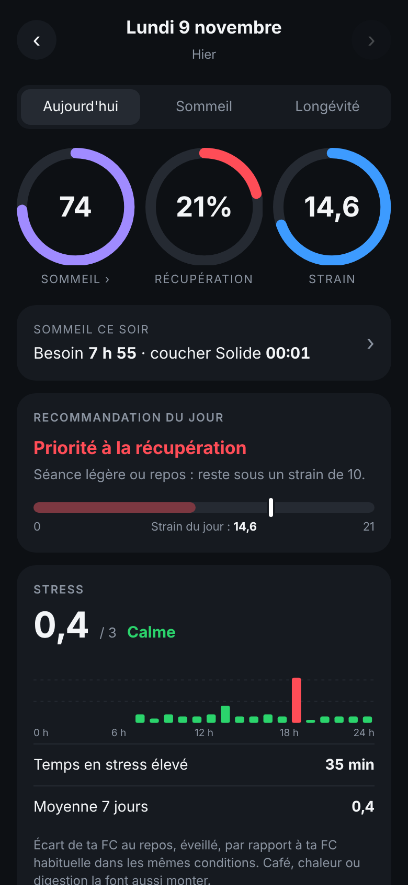
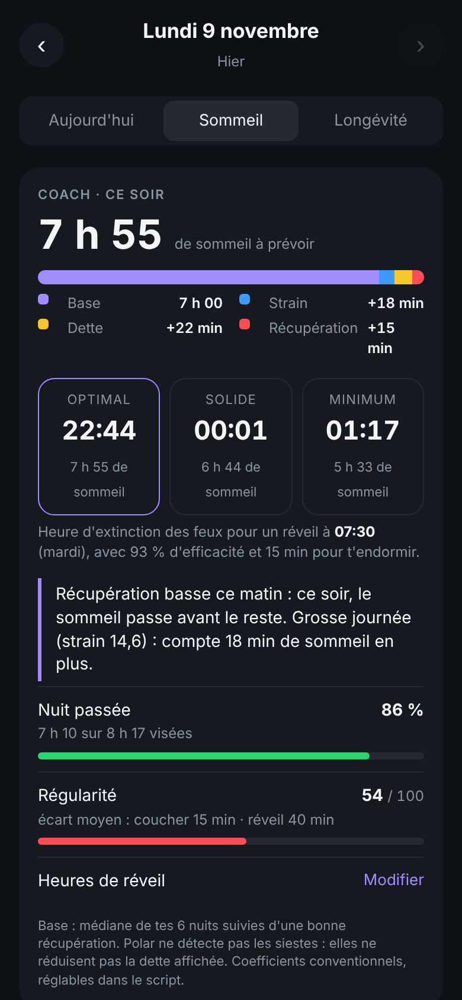
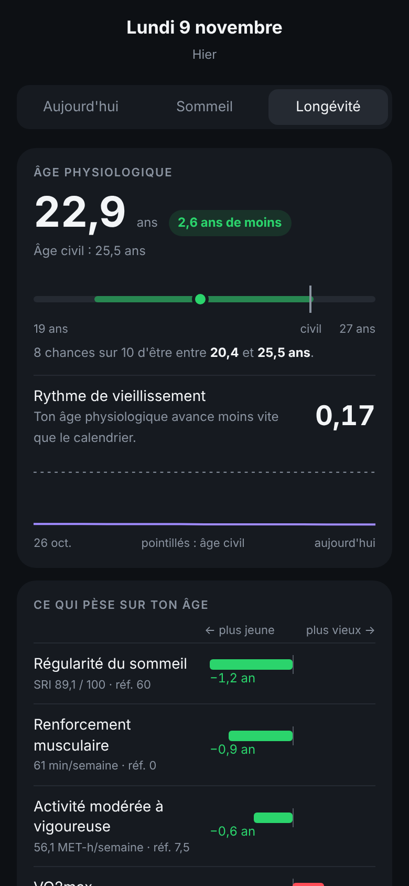

# Polar Dashboard

🇫🇷 [Version française](README.fr.md)

A Google Apps Script that reads data from a **Polar** watch through the official **Polar AccessLink** API, computes daily
metrics in a **Google Sheet** and shows them in a **private web dashboard** designed for your phone.

Everything runs inside your own Google account: no server, no subscription, no external database.

> The dashboard and the Sheet are in French. The code follows French naming (identifiers, comments); this documentation
> is available in English and French.

| Today | Sleep | Longevity |
|---|---|---|
|  |  |  |

<sub>Screenshots made with fictional data generated by the test simulator.</sub>

## Features

- **Recovery (0–100)** from overnight HRV, heart rate and breathing rate plus the sleep score, compared with your own
  28-day baseline. Green / yellow / red zones and an effort recommendation.
- **Strain (0–21)** for the whole day: recorded workouts + continuous heart rate outside workouts.
- **Stress** hour by hour: how far your awake resting heart rate is above your own reference.
- **Activity**: steps, calories, training load (acute/chronic ratio).
- **Sleep**: hypnogram, stages, continuity, overnight heart rate / HRV / breathing, Nightly Recharge, last 7 nights.
- **Sleep coach**: tonight's sleep need (baseline, strain, sleep debt, recovery) and three suggested bedtimes for your
  wake-up time, which you can set for each day of the week from the dashboard.
- **Longevity**: physiological age with an uncertainty interval and pace of aging, computed from published
  dose-response curves (VO2max, resting heart rate, steps, physical activity, strength training, sleep duration and
  regularity).
- **Journal**: tick "alcohol" or "late meal" in the Sheet to see their effect on next-day recovery.

Formulas and sources: [docs/METHODOLOGY.md](docs/METHODOLOGY.md). Sheet structure: [docs/SHEETS.md](docs/SHEETS.md).

## Requirements

- A Polar watch synced with Polar Flow, with continuous heart rate turned on.
- A Google account.
- For local development (optional): Node.js 18+ and [clasp](https://github.com/google/clasp).

## Setup

### 1. Create the Sheet and the script

1. Create an empty Google Sheet.
2. Open **Extensions → Apps Script**.
3. Replace the content of `Code.gs` with [`src/Code.js`](src/Code.js).
4. Add an HTML file named exactly **`Dashboard`** and paste [`src/Dashboard.html`](src/Dashboard.html) into it.
5. In **Project settings**, tick "Show appsscript.json manifest file" and replace `appsscript.json` with
   [`src/appsscript.json`](src/appsscript.json) (Europe/Paris time zone, web app). Change `timeZone` if needed.

With clasp instead: copy `.clasp.json.example` to `.clasp.json`, put your script ID in it, then run `clasp push`.

### 2. Deploy the web app

**Deploy → New deployment → Web app**:

- Execute as: **Me**;
- Who has access: **Anyone** (needed for the Polar callback and for access from your phone; the dashboard is still
  protected by a private key).

Copy the URL ending in `/exec`. **Never create a new deployment after that**: the URL would change and both the Polar
connection and your dashboard link would break. To publish an update, edit the existing deployment ("Manage
deployments → Edit → New version"), or with clasp:

```bash
clasp deploy -i <DEPLOYMENT_ID> -d "description"
```

### 3. Create the Polar AccessLink client

1. On [admin.polaraccesslink.com](https://admin.polaraccesslink.com), create an API client.
2. Set its **redirect URL** to the `/exec` URL from step 2.
3. In Apps Script, **Project settings → Script properties**, add `CLIENT_ID` and `CLIENT_SECRET`.

### 4. Connect your Polar account

1. Run the `afficherLienAutorisation` function (from the Sheet's **Polar** menu, or from the editor: the link is in the
   execution log).
2. Open the link and grant access: the "Connexion Polar réussie" page appears.

### 5. First data and automatic updates

1. Run `majQuotidienne` once (Google asks for permissions on the first run).
2. Run `installerDeclencheurs`: automatic updates at 9:00, 13:00 and 21:00.
3. Run `creerLienDashboard`: it shows your private link (`…/exec?k=…`). Open it on your phone and add it to your home
   screen. **Do not share this link**: the key inside it gives access to your data.

Main functions (names are in French):

| Function | Purpose |
|---|---|
| `afficherLienAutorisation` | Shows the Polar authorization link |
| `majQuotidienne` | Daily update: fetches Polar data and fills the Sheet |
| `installerDeclencheurs` | Installs the automatic updates |
| `creerLienDashboard` | Creates the private dashboard key and shows the link |
| `diagnostic` | Logs the shape of the Polar data, without writing anything |

## Security and data

- Secrets (`CLIENT_ID`, `CLIENT_SECRET`, `ACCESS_TOKEN`, `DASH_KEY`) stay in the **script properties**. They are never
  written to the code, the Sheet or the dashboard.
- Your data stays in your Google Sheet. The script only calls the Polar API.
- To reconnect to Polar: delete the `ACCESS_TOKEN` property, then redo step 4.
- `.clasp.json` (your script ID) is ignored by git.

## Development

```bash
npm test          # unit and integration tests (no network, no account needed)
npm run apercu    # writes apercu.html: the dashboard with fictional data, to open in a browser
```

- `tests/simulateur.js` simulates Google Sheets, UrlFetch and a fictional Polar API, so `majQuotidienne` runs end to end
  locally.
- Code style: French identifiers, private functions end with `_`, all constants live in `CFG`.
- The dashboard's ↻ button runs the **deployed** version: after a `clasp push`, run `majQuotidienne` from the editor
  until you redeploy.

## Structure

```
src/
  Code.js            Apps Script code (Polar API, calculations, Sheet, web app)
  Dashboard.html     dashboard (HTML, CSS and dependency-free JavaScript)
  appsscript.json    Apps Script manifest
tests/               node tests and Google services simulator
outils/apercu.js     local dashboard preview with fictional data
docs/                methodology, Sheet structure, screenshots (French versions in docs/fr/)
```

## Limitations

- This is **not a medical device** and nothing it shows is medical advice.
- Recovery / strain-style metrics and the sleep coach follow logic popularised by fitness wearables, with conventional
  coefficients: commercial formulas are not published.
- Physiological age reflects a relative risk derived from observational studies, mostly in people aged 40–70.
- Polar does not detect naps.

Personal project, not affiliated with Polar Electro or any wearable brand. Polar, Polar Flow and Polar AccessLink are
trademarks of Polar Electro Oy.

## License

No license is granted: all rights reserved. The code can be read, but reusing, modifying or redistributing it requires
the author's permission.
